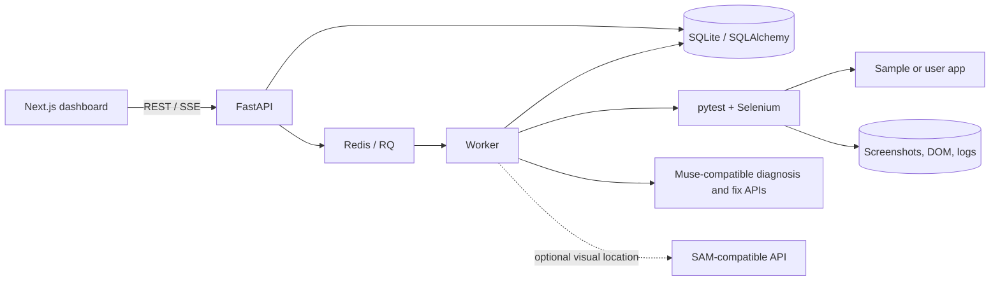

<div align="center">

# HealTest

### A review-first repair workflow for failing Selenium UI tests

Collect browser evidence, diagnose a failure, propose a guarded test-only patch,
and verify it in a copy of the test suite. Keep a person in control of approval.

**FastAPI · Next.js · pytest · Selenium · Chromium · Docker · Redis/RQ**

</div>

> [!IMPORTANT]
> **Prototype, not production-ready.** The offline/mock workflow and local
> dashboard are implemented, but live model and visual-provider acceptance
> remains unverified. A mock benchmark is useful for exercising the harness;
> it does not demonstrate live-model effectiveness or meet the heal-rate
> target. Review all proposed changes.

## At a glance

| | |
| --- | --- |
| **Purpose** | Diagnose and safely review repairs for failing Selenium/pytest UI tests |
| **Workflow** | Collect evidence → diagnose → optionally locate visually → propose patch → safety-check → verify twice |
| **Sample apps** | Three static apps with 29 Selenium tests |
| **Offline mode** | Deterministic mock responses; no provider credentials needed |
| **Run locally** | Docker Compose, API at `localhost:8000`, dashboard at `localhost:3000` |

<details>
<summary>Contents</summary>

- [Product tour](#product-tour)
- [What HealTest does](#what-healtest-does)
- [Architecture](#architecture)
- [Quick start](#quick-start)
- [Try a sample run](#try-a-sample-run)
- [API surface](#api-surface)
- [Configure model and visual APIs](#configure-model-and-visual-apis)
- [Benchmark](#benchmark)
- [Development and tests](#development-and-tests)
- [Safety and deployment notes](#safety-and-deployment-notes)
- [Repository map and further reading](#repository-map)

</details>

## Product tour

These are captures of the running local dashboard. The benchmark view is the
dashboard/API two-case example; the full 42-case result is reported separately
below.

<table>
  <tr>
    <td align="center" width="50%"><br><sub>Workspace overview</sub></td>
    <td align="center" width="50%"><br><sub>Run review — healed status and repair-attempt summary</sub></td>
  </tr>
  <tr>
    <td align="center" colspan="2"><br><sub>Benchmark comparison — seeded two-case dashboard sample</sub></td>
  </tr>
</table>

## What HealTest does

1. **Runs a test suite** in a worker and records test outcomes.
2. **Collects evidence** for failures: screenshot, DOM snapshot, browser
   console, error and stack trace, URL, and visible-element bounding boxes.
3. **Diagnoses the failure** using a configured Muse-compatible endpoint or
   deterministic mock mode. Suspected application bugs are escalated instead
   of patched.
4. **Proposes a test-only unified diff.** The optional visual path segments a
   screenshot through a configured SAM-compatible service and matches the
   mask to a visible DOM candidate.
5. **Checks and verifies the patch** in a temporary copy. Safety checks cover
   allowed paths, diff size, assertion preservation, and locator uniqueness;
   the affected test must pass twice to count as healed.
6. **Presents the result for review.** A person can approve, reject, or
   download a proposal. Approval creates a separate copy; the original project
   files are not changed.

### Included sample apps

| App | Selenium tests |
| --- | ---: |
| Todo | 10 |
| Shop | 10 |
| Multistep form | 9 |
| **Total** | **29** |

## Architecture



In Compose, the API, Redis, worker, dashboard, and sample-app server run as
separate services. The worker delegates each test run to a fresh constrained
container on a separately managed, isolated Docker host over mutual TLS. The
test image, target app, and sandbox network must be available on that host;
model calls are made by the worker, not by the test container.

### Repair states

`QUEUED → RUNNING → COLLECT → DIAGNOSE → [LOCATE] → FIX → CHECK → VERIFY`

Successful, consistent verification is marked **healed**; inconsistent reruns
are marked **flaky**. Unsafe proposals, suspected application bugs, unresolved
failures, and exhausted retries are escalated for human review.

Read more in [the architecture guide](docs/architecture.md).

## Quick start

### Requirements

- Docker Desktop (or Docker Engine) with the Compose plugin
- Git, to clone the repository

No model keys are needed for the default mock-mode demo.

### Start the stack

From the repository root, copy the example environment file and start Compose:

```powershell
Copy-Item .env.example .env
# Generate a token, then set HEALTEST_API_TOKEN in .env to that value.
py -c "import secrets; print(secrets.token_urlsafe(32))"
# Generate a Redis password, then set REDIS_PASSWORD in .env to that value.
py -c "import secrets; print(secrets.token_hex(32))"
docker compose up --build -d
```

Or use the PowerShell helper, which also waits for API health:

```powershell
.\scripts\start.ps1
```

For macOS/Linux:

```sh
cp .env.example .env
# Generate a token, then set HEALTEST_API_TOKEN in .env to that value.
python3 -c "import secrets; print(secrets.token_urlsafe(32))"
# Generate a Redis password, then set REDIS_PASSWORD in .env to that value.
python3 -c "import secrets; print(secrets.token_hex(32))"
docker compose up --build -d
```

The local Compose API uses a development-only shared token. Set it in
`.env` and enter it in the dashboard's **Settings** page. Production must not
use this mode; it requires Cognito authentication. Compose also
requires `REDIS_PASSWORD`; it configures Redis authentication and passes the
authenticated URL to both API and worker. Redis is not published to a host
port. The worker additionally requires a dedicated sandbox Docker host, its
mutual-TLS client certificates, a pre-created isolated sandbox network, an
allowed target hostname, and a sandbox image available on that host. Do not
point it at the Docker daemon for the machine running HealTest.

For sandbox configuration, set these values in `.env`:

```dotenv
HEALTEST_SANDBOX_DOCKER_HOST=tcp://sandbox-vm.example.internal:2376
HEALTEST_DOCKER_CERT_PATH=C:/secure/healtest-docker-certs
HEALTEST_SANDBOX_IMAGE=registry.example.internal/healtest-worker:<pinned-tag>
HEALTEST_SANDBOX_NETWORK=healtest-sandbox
HEALTEST_SANDBOX_ALLOWED_HOSTS=sample-apps
```

The certificate directory must contain `ca.pem`, `cert.pem`, and `key.pem`;
keep it outside the repository and readable only by the operator. Provision
the Docker daemon on a dedicated VM or host, require mutual TLS, restrict
access to the worker, and do not expose an unauthenticated Docker API. Create
the named sandbox network on that daemon and make the target app reachable
from it (for example, deploy the sample app there with the allowed hostname).
Build and publish the sandbox image to a registry accessible to that daemon,
or load it onto that daemon in advance. Use a pinned image tag or digest.
Compose fails if the remote endpoint or required settings are unset, and the
runner rejects local-socket or non-TLS Docker endpoints.

The Compose HTTP ports bind only to `127.0.0.1`, so they are intended for
local access and are not directly reachable from other machines. For a public
or remote deployment, terminate HTTPS at a maintained reverse proxy or load
balancer and keep the application ports private; do not change these bindings
to `0.0.0.0` or expose the plain-HTTP API directly. Configure the dashboard's
API URL to use the HTTPS public API origin in that deployment.

| Service | Local URL |
| --- | --- |
| Dashboard | <http://localhost:3000> |
| API | <http://localhost:8000> |
| API health | <http://localhost:8000/health> |
| Interactive API docs | <http://localhost:8000/docs> |
| Sample apps | <http://localhost:8901/todo/> · <http://localhost:8901/shop/> · <http://localhost:8901/multistep-form/> |

Check health and stop the stack:

```powershell
Invoke-RestMethod http://localhost:8000/health
docker compose down
```

The local SQLite database and run artifacts are stored under
`backend/data/`. Compose mounts that directory into the API and worker.

## Public deployment: Vercel frontend and AWS backend

The Compose stack is for local development and is not the production
deployment. A public deployment needs these separately provisioned resources:

- **Vercel:** deploy `frontend/`. Set `NEXT_PUBLIC_API_URL` to the HTTPS API
  origin, `NEXT_PUBLIC_COGNITO_DOMAIN` to the Cognito hosted UI domain, and
  `NEXT_PUBLIC_COGNITO_CLIENT_ID` to a Cognito public app-client ID. These
  values are public configuration, not secrets. Set the exact Vercel
  production URL plus `/auth/callback` as an allowed Cognito callback, and
  the Vercel root URL as an allowed sign-out URL. Configure Cognito for
  authorization-code flow with PKCE and `openid email`; do not create a
  client secret for the browser app.
- **AWS API:** deploy FastAPI as a private ECS service behind an HTTPS ALB with
  an ACM certificate. Configure `HEALTEST_ENV=production`,
  `HEALTEST_AUTH_MODE=cognito`, `COGNITO_REGION`, `COGNITO_USER_POOL_ID`,
  `COGNITO_APP_CLIENT_ID`, and `HEALTEST_CORS_ORIGINS` set only to the exact
  HTTPS Vercel origin. API task secrets must come from Secrets Manager.
- **Persistence and queue:** use encrypted RDS PostgreSQL with automated
  backups and configure `DATABASE_URL` with `sslmode=verify-full` (plus the
  trusted RDS CA certificate); production rejects PostgreSQL URLs without TLS.
  Use an in-transit-encryption-enabled
  ElastiCache Redis and a `rediss://` `REDIS_URL`. Mount the same encrypted,
  backed-up EFS filesystem at `HEALTEST_DATA_DIR` on both API and worker tasks
  so artifact files and approved copies are durable and shared. Configure
  AWS Backup and test a restore before accepting customer data.
- **Worker sandbox:** run the RQ worker privately and connect it over mutual
  TLS to a separate, dedicated sandbox EC2 host. Restrict its security group
  to the worker; provision a pre-created isolated Docker network and a
  pinned sandbox image on that host. The worker's TLS client certificate
  must be mounted read-only and stored as a secret. The sandbox network must
  reach only approved test targets; model API calls remain outside it.
- **Operations:** before deploying the API, run a one-off migration task with
  the same database configuration: `python -m app.maintenance migrate`.
  Production API startup refuses automatic schema migration. Run a scheduled
  ECS task at least once per minute with
  `python -m app.maintenance sweep-stale-jobs`. Send service logs to
  CloudWatch and alert on unhealthy tasks, API 5xx, queue backlog, and
  database/storage alarms. Configure RDS/EFS backups and verify recovery.
- **Providers:** set model and SAM credentials in Secrets Manager and inject
  them only into the worker. Set `HEALTEST_MOCK_MODE=0`; run live-provider
  repair and benchmark acceptance in staging before production traffic.

HealTest currently assigns a workspace to one Cognito user (`sub`); shared
organization/team membership and roles are not implemented. This provides
user-level tenant isolation, not collaborative organization accounts. Existing
unowned local projects are not automatically assigned to a Cognito user.
This repository does not provision AWS or Vercel resources; the service is
not production-ready until the selected resources, domains, secrets, backups,
and staging checks are configured and exercised.

## Try a sample run

Use the dashboard to create a project with the sample-app URL and the
worker-container test path:

- **App URL:** `http://sample-apps:8901`
- **Test path:** `/sample_apps/todo/tests`

Then start a run from that project. The run detail page shows its status,
test results, repair timeline, captured evidence, and any proposed diff.

For a repeatable passing-run walkthrough:

```powershell
.\scripts\demo.ps1
```

The script creates a project, submits the sample suite, and waits for the
result. It demonstrates the Compose, worker, and dashboard workflow; a passing
run is not evidence of live AI repair. See
[the demo script and recording guide](docs/demo-script.md).

### Start a run through the API

The test path is interpreted **inside the worker container**. The app URL
below uses the Compose service name so the worker can reach it.

```powershell
$apiToken = (Select-String -Path .env -Pattern '^HEALTEST_API_TOKEN=').Line.Substring('HEALTEST_API_TOKEN='.Length)
$headers = @{ Authorization = "Bearer $apiToken" }

$project = Invoke-RestMethod `
  -Method Post `
  -Uri http://localhost:8000/projects `
  -ContentType 'application/json' `
  -Headers $headers `
  -Body '{"name":"todo","app_url":"http://sample-apps:8901","test_path":"/sample_apps/todo/tests"}'

$run = Invoke-RestMethod `
  -Method Post `
  -Uri "http://localhost:8000/projects/$($project.id)/runs" `
  -Headers $headers

Invoke-RestMethod "http://localhost:8000/runs/$($run.id)" -Headers $headers
```

## API surface

Interactive request/response schemas are available at
<http://localhost:8000/docs>.

| Method | Path | Purpose |
| --- | --- | --- |
| `GET` | `/health` | Health check |
| `GET`, `POST` | `/projects` | List or create projects |
| `POST` | `/projects/{project_id}/runs` | Submit a test run |
| `GET` | `/runs` | List runs |
| `GET` | `/runs/{run_id}` | Get results, attempts, patches, and artifacts |
| `GET` | `/runs/{run_id}/events` | Read run events (SSE snapshot) |
| `POST` | `/patches/{patch_id}/approve` | Approve a proposal into a separate copy |
| `POST` | `/patches/{patch_id}/reject` | Reject a proposal |
| `GET` | `/patches/{patch_id}/download` | Download a proposal diff |
| `GET`, `POST` | `/benchmarks` | List or start a seeded benchmark |
| `GET` | `/benchmarks/{benchmark_id}` | Read benchmark status and results |

Protected routes always require authentication. Local Compose uses
`HEALTEST_AUTH_MODE=local-token`; production must use verified Cognito access
tokens and fails startup if Cognito settings are missing. `/health` and
`/health/ready` remain public for load-balancer probes.

## Configure model and visual APIs

Copy `.env.example` to `.env` and set credentials **there**, not in source
files or frontend code. Compose passes the environment to the API and worker.
In local development, the dashboard's Settings page configures that browser's
API URL/token; it is **not** where model-provider keys belong. Cognito
deployments use deployment-managed API settings instead of browser overrides.

For live diagnosis and patch generation, set `HEALTEST_MOCK_MODE=0` and provide
the provider-issued OpenAI-compatible chat-completions URL, model identifier,
and key for each configured Muse-compatible endpoint:

```dotenv
HEALTEST_MOCK_MODE=0
MUSE_SPARK_API_URL=
MUSE_SPARK_API_KEY=
MUSE_SPARK_MODEL=
MUSE_CODE_API_URL=
MUSE_CODE_API_KEY=
MUSE_CODE_MODEL=
```

Keep the provider URL, model name, and key supplied by your provider; HealTest
does not guess them. For the optional visual fallback, configure the
provider-compatible SAM endpoint and key:

```dotenv
SAM_API_URL=
SAM_API_KEY=
```

Visual segmentation is attempted only when diagnosis requests it. The adapter
expects a bearer-authenticated JSON request containing a base64 PNG and text
prompt, and a same-size mask response. Verify your provider's contract before
enabling this path. Live Muse and SAM integration has **not** been validated
in this workspace.

### Important environment settings

| Variable | Purpose |
| --- | --- |
| `HEALTEST_MOCK_MODE` | Use deterministic offline responses (`1`) or require configured providers (`0`) |
| `HEALTEST_API_TOKEN` | Local development only; never use in production |
| `HEALTEST_AUTH_MODE` | `cognito` for production; `local-token` only for development |
| `COGNITO_REGION` / `COGNITO_USER_POOL_ID` / `COGNITO_APP_CLIENT_ID` | Cognito access-token validation settings |
| `HEALTEST_CORS_ORIGINS` | Allowed browser origins; defaults to local dashboard origins |
| `DATABASE_URL` | PostgreSQL in production; SQLite is local Compose only |
| `REDIS_PASSWORD` | Required by local Compose to authenticate API/worker Redis connections |
| `REDIS_URL` | Shared Redis/RQ and rate-limit store; production requires TLS (`rediss://`) |
| `HEALTEST_DATA_DIR` | Shared persistent artifact volume mounted by API and worker |
| `HEALTEST_AUTO_MIGRATE` | Production must be `0`; run the one-off migration task first |
| `HEALTEST_SANDBOX` | `auto` (requires Docker, never falls back), `docker`, or `local` (trusted development only) |
| `HEALTEST_SANDBOX_DOCKER_HOST` | Isolated remote Docker endpoint used by the Compose worker |
| `HEALTEST_DOCKER_CERT_PATH` | Host path to the remote daemon's mutual-TLS client certificates |
| `HEALTEST_SANDBOX_IMAGE` | Image already available to the remote sandbox daemon |
| `HEALTEST_SANDBOX_NETWORK` | Pre-created isolated network on the remote daemon |
| `HEALTEST_SANDBOX_ALLOWED_HOSTS` | Target hostnames reachable from that network |
| `HEALTEST_TIMEOUT_S` | Pytest wall-clock timeout |
| `HEALTEST_MODEL_TIMEOUT_S` | Diagnosis request timeout |
| `HEALTEST_MAX_REQUEST_BYTES` | API request-body cap (default 1 MiB) |
| `HEALTEST_JOB_RATE_LIMIT` / `HEALTEST_JOB_RATE_WINDOW_S` | Per-user job submission limit stored in shared Redis in production (defaults: 10 per 60 seconds) |
| `HEALTEST_JOB_TIMEOUT_S` / `HEALTEST_STALE_JOB_GRACE_S` | RQ timeout and stale-job grace period |
| `HEALTEST_SANDBOX_IMAGE` | Image used for fresh per-run containers |
| `HEALTEST_SANDBOX_NETWORK` / `HEALTEST_SANDBOX_ALLOWED_HOSTS` | Docker network and allowed test target hosts |
| `HEALTEST_SANDBOX_CPUS` / `HEALTEST_SANDBOX_MEMORY` | Per-container resource limits |
| `CHROMEDRIVER_PATH` | Optional explicit ChromeDriver path |

## Benchmark

The fixed-seed benchmark generates **42 Selenium cases** across three sample
apps and seven UI mutations. It compares no healing, a deterministic locator
heuristic, and the HealTest repair workflow. Only passing verification reruns
count as HealTest successes.

The full matrix was run in the Compose worker with Chromium in deterministic
mock mode:

| Arm | Healed | Rate |
| --- | ---: | ---: |
| No healing | 0 / 42 | 0% |
| Heuristic | 42 / 42 | 100% |
| HealTest mock | 0 / 42 | 0% |

There were **zero unsafe fixes** in that run. This result is an offline
workflow/harness measurement, **not** evidence that a live provider heals
tests, nor evidence that the project meets its target heal rate. The
dashboard/API reporting path was also checked with a separate seeded
two-case mock run; the screenshot above shows that smaller example.

Run the full matrix from the repository root where Python, the backend
dependencies, Chromium, and ChromeDriver are available:

```powershell
py -3 -m benchmark.runner --seed 42
```

The runner writes `benchmark/results.json` and `benchmark/results.svg`.
Select a subset or enable optional token-cost reporting with:

```powershell
py -3 -m benchmark.runner --seed 42 --apps todo,shop --mutations renamed_id,button_text
py -3 -m benchmark.runner --seed 42 --cost-per-1k-tokens 0.02
```

The dashboard's **Benchmarks** page submits seeded benchmark jobs through the
API. See [the benchmark method](docs/benchmark-method.md) for matrix details,
arms, and metric definitions.

## Development and tests

### Backend

Install backend and worker dependencies, then run backend and benchmark tests
from the backend directory:

```powershell
py -3 -m pip install -r backend/requirements.txt -r worker/requirements.txt
Set-Location backend
py -3 -m pytest tests ..\benchmark\tests -q
Set-Location ..
```

The recent complete backend and benchmark suite passed **200 tests**. Run the
repository secret scan with:

```powershell
py -3 scripts/check_secrets.py
```

### Frontend

Node.js 20.9 or newer:

```powershell
Set-Location frontend
npm ci
npm run lint
npm run build
```

The frontend reads the API URL from browser-local settings; Compose defaults
to `http://localhost:8000`.

### Sample apps without Compose

Serve the static apps from the repository root:

```powershell
py -3 -m http.server 8901 --directory sample_apps
```

Run a suite in a second terminal. Direct execution additionally requires
pytest, Selenium, a compatible Chrome/Chromium browser, and its driver:

```powershell
$env:APP_URL = 'http://localhost:8901'
Set-Location sample_apps/todo/tests
py -3 -m pytest -q
```

## Safety and deployment notes

- Proposed diffs are restricted to test files and checked before verification.
- Verification and approval operate on copies; HealTest does not automatically
  modify the original project tree.
- Docker sandbox mode uses a fresh container with resource limits,
  read-only filesystem, dropped capabilities, and a pre-created isolated
  network. The worker connects to a separately managed Docker daemon over
  mutual TLS; it does not mount the HealTest host's Docker socket.
- The remote daemon still grants container-management privileges to the
  worker. Run it on a dedicated isolated host/VM, restrict network access to
  the worker, and do not treat mutual TLS alone as a sandbox boundary.
- Compose publishes the dashboard, API, and sample apps on loopback only.
  Public deployments must use a TLS-terminating reverse proxy/load balancer;
  never expose the Compose HTTP ports directly to an untrusted network.
- `auto` never falls back to local execution if Docker is unavailable.
  `HEALTEST_SANDBOX=local` is an explicit trusted-development opt-in only:
  test code runs with the worker's environment and filesystem permissions.
  Never use local mode for untrusted projects.
- Safety checks are conservative guards, not a security boundary or a complete
  semantic proof that assertions are preserved. Review every diff.
- Production job rate limiting uses shared Redis; the in-memory limiter is for
  local development only. Production stale-job cleanup requires scheduling
  `python -m app.maintenance sweep-stale-jobs`. SQLite migration support is
  intentionally small.

## Repository map

```text
backend/app/       FastAPI API, persistence, orchestration, safety, AI/vision adapters
backend/tests/     Backend tests
worker/            RQ worker image, pytest evidence plugin, runner
frontend/          Next.js dashboard
sample_apps/       Static demo apps and Selenium suites
benchmark/         Seeded mutations, runner, heuristic baseline
docs/              Architecture, benchmark method, demo guide, acceptance checklist
```

## Further reading

- [Architecture and trust boundaries](docs/architecture.md)
- [Benchmark method and metric definitions](docs/benchmark-method.md)
- [Three-minute demo and recording guide](docs/demo-script.md)
- [Submission and acceptance checklist](docs/submission-checklist.md)
- [Sample app suites](sample_apps/README.md)
- [Implementation phases and current status](implementation.md)
