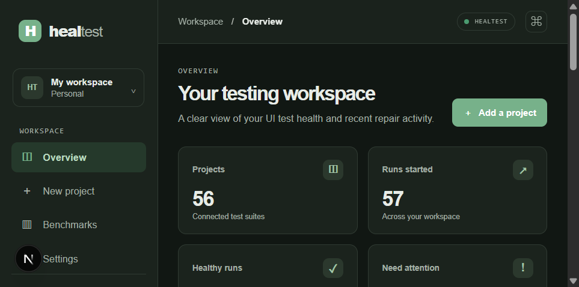
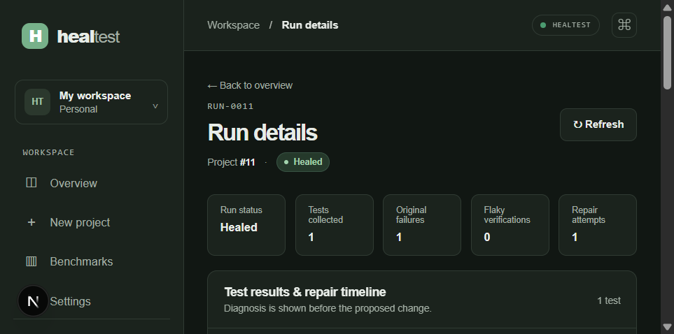
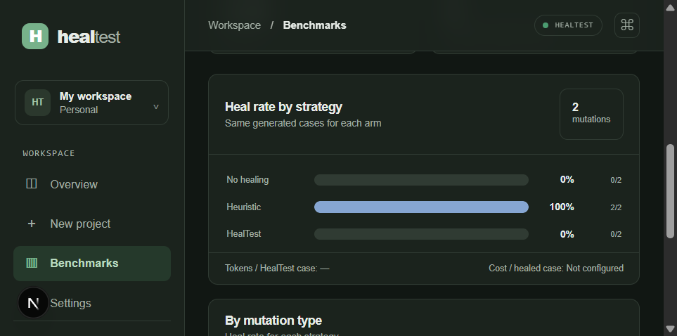
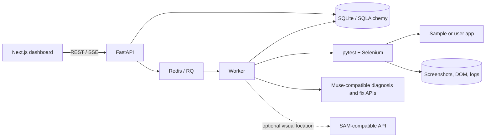

<div align="center">

# HealTest

### A review-first repair workflow for failing Selenium UI tests

Collect browser evidence, diagnose a failure, propose a guarded test-only patch,
and verify it in a copy of the test suite. Keep a person in control of approval.

**FastAPI · Next.js · pytest · Selenium · Chromium · Docker · Redis/RQ**

</div>

> [!IMPORTANT]
> **Prototype, not production-ready.** The offline/mock workflow and local
> dashboard are implemented, but live model and visual-provider acceptance
> remains unverified. A mock benchmark is useful for exercising the harness;
> it does not demonstrate live-model effectiveness or meet the heal-rate
> target. Review all proposed changes.

## At a glance

| | |
| --- | --- |
| **Purpose** | Diagnose and safely review repairs for failing Selenium/pytest UI tests |
| **Workflow** | Collect evidence → diagnose → optionally locate visually → propose patch → safety-check → verify twice |
| **Sample apps** | Three static apps with 29 Selenium tests |
| **Offline mode** | Deterministic mock responses; no provider credentials needed |
| **Run locally** | Docker Compose, API at `localhost:8000`, dashboard at `localhost:3000` |

<details>
<summary>Contents</summary>

- [Product tour](#product-tour)
- [What HealTest does](#what-healtest-does)
- [Architecture](#architecture)
- [Quick start](#quick-start)
- [Try a sample run](#try-a-sample-run)
- [API surface](#api-surface)
- [Configure model and visual APIs](#configure-model-and-visual-apis)
- [Benchmark](#benchmark)
- [Development and tests](#development-and-tests)
- [Safety and deployment notes](#safety-and-deployment-notes)
- [Repository map and further reading](#repository-map)

</details>

## Product tour

These are captures of the running local dashboard. The benchmark view is the
dashboard/API two-case example; the full 42-case result is reported separately
below.

<table>
  <tr>
    <td align="center" width="50%"><br><sub>Workspace overview</sub></td>
    <td align="center" width="50%"><br><sub>Run review — healed status and repair-attempt summary</sub></td>
  </tr>
  <tr>
    <td align="center" colspan="2"><br><sub>Benchmark comparison — seeded two-case dashboard sample</sub></td>
  </tr>
</table>

## What HealTest does

1. **Runs a test suite** in a worker and records test outcomes.
2. **Collects evidence** for failures: screenshot, DOM snapshot, browser
   console, error and stack trace, URL, and visible-element bounding boxes.
3. **Diagnoses the failure** using a configured Muse-compatible endpoint or
   deterministic mock mode. Suspected application bugs are escalated instead
   of patched.
4. **Proposes a test-only unified diff.** The optional visual path segments a
   screenshot through a configured SAM-compatible service and matches the
   mask to a visible DOM candidate.
5. **Checks and verifies the patch** in a temporary copy. Safety checks cover
   allowed paths, diff size, assertion preservation, and locator uniqueness;
   the affected test must pass twice to count as healed.
6. **Presents the result for review.** A person can approve, reject, or
   download a proposal. Approval creates a separate copy; the original project
   files are not changed.

### Included sample apps

| App | Selenium tests |
| --- | ---: |
| Todo | 10 |
| Shop | 10 |
| Multistep form | 9 |
| **Total** | **29** |

## Architecture



In Compose, the API, Redis, worker, dashboard, and sample-app server run as
separate services. The worker starts a fresh constrained Docker container for
each test run. The test container is placed on an internal network for the
target app; model calls are made by the worker, not by the test container.

### Repair states

`QUEUED → RUNNING → COLLECT → DIAGNOSE → [LOCATE] → FIX → CHECK → VERIFY`

Successful, consistent verification is marked **healed**; inconsistent reruns
are marked **flaky**. Unsafe proposals, suspected application bugs, unresolved
failures, and exhausted retries are escalated for human review.

Read more in [the architecture guide](docs/architecture.md).

## Quick start

### Requirements

- Docker Desktop (or Docker Engine) with the Compose plugin
- Git, to clone the repository

No model keys are needed for the default mock-mode demo.

### Start the stack

From the repository root, copy the example environment file and start Compose:

```powershell
Copy-Item .env.example .env
docker compose up --build -d
```

Or use the PowerShell helper, which also waits for API health:

```powershell
.\scripts\start.ps1
```

For macOS/Linux:

```sh
cp .env.example .env
docker compose up --build -d
```

| Service | Local URL |
| --- | --- |
| Dashboard | <http://localhost:3000> |
| API | <http://localhost:8000> |
| API health | <http://localhost:8000/health> |
| Interactive API docs | <http://localhost:8000/docs> |
| Sample apps | <http://localhost:8901/todo/> · <http://localhost:8901/shop/> · <http://localhost:8901/multistep-form/> |

Check health and stop the stack:

```powershell
Invoke-RestMethod http://localhost:8000/health
docker compose down
```

The local SQLite database and run artifacts are stored under
`backend/data/`. Compose mounts that directory into the API and worker.

## Try a sample run

Use the dashboard to create a project with the sample-app URL and the
worker-container test path:

- **App URL:** `http://sample-apps:8901`
- **Test path:** `/sample_apps/todo/tests`

Then start a run from that project. The run detail page shows its status,
test results, repair timeline, captured evidence, and any proposed diff.

For a repeatable passing-run walkthrough:

```powershell
.\scripts\demo.ps1
```

The script creates a project, submits the sample suite, and waits for the
result. It demonstrates the Compose, worker, and dashboard workflow; a passing
run is not evidence of live AI repair. See
[the demo script and recording guide](docs/demo-script.md).

### Start a run through the API

The test path is interpreted **inside the worker container**. The app URL
below uses the Compose service name so the worker can reach it.

```powershell
$project = Invoke-RestMethod `
  -Method Post `
  -Uri http://localhost:8000/projects `
  -ContentType 'application/json' `
  -Body '{"name":"todo","app_url":"http://sample-apps:8901","test_path":"/sample_apps/todo/tests"}'

$run = Invoke-RestMethod `
  -Method Post `
  -Uri "http://localhost:8000/projects/$($project.id)/runs"

Invoke-RestMethod "http://localhost:8000/runs/$($run.id)"
```

## API surface

Interactive request/response schemas are available at
<http://localhost:8000/docs>.

| Method | Path | Purpose |
| --- | --- | --- |
| `GET` | `/health` | Health check |
| `GET`, `POST` | `/projects` | List or create projects |
| `POST` | `/projects/{project_id}/runs` | Submit a test run |
| `GET` | `/runs` | List runs |
| `GET` | `/runs/{run_id}` | Get results, attempts, patches, and artifacts |
| `GET` | `/runs/{run_id}/events` | Read run events (SSE snapshot) |
| `POST` | `/patches/{patch_id}/approve` | Approve a proposal into a separate copy |
| `POST` | `/patches/{patch_id}/reject` | Reject a proposal |
| `GET` | `/patches/{patch_id}/download` | Download a proposal diff |
| `GET`, `POST` | `/benchmarks` | List or start a seeded benchmark |
| `GET` | `/benchmarks/{benchmark_id}` | Read benchmark status and results |

Set `HEALTEST_API_TOKEN` to enable API token authentication on protected
routes. It is blank in `.env.example` for local development.

## Configure model and visual APIs

Copy `.env.example` to `.env` and set credentials **there**, not in source
files or frontend code. Compose passes the environment to the API and worker.
The dashboard's Settings page is for the browser's API URL/token; it is **not**
where model-provider keys belong.

For live diagnosis and patch generation, set `HEALTEST_MOCK_MODE=0` and provide
the provider-issued OpenAI-compatible chat-completions URL, model identifier,
and key for each configured Muse-compatible endpoint:

```dotenv
HEALTEST_MOCK_MODE=0
MUSE_SPARK_API_URL=
MUSE_SPARK_API_KEY=
MUSE_SPARK_MODEL=
MUSE_CODE_API_URL=
MUSE_CODE_API_KEY=
MUSE_CODE_MODEL=
```

Keep the provider URL, model name, and key supplied by your provider; HealTest
does not guess them. For the optional visual fallback, configure the
provider-compatible SAM endpoint and key:

```dotenv
SAM_API_URL=
SAM_API_KEY=
```

Visual segmentation is attempted only when diagnosis requests it. The adapter
expects a bearer-authenticated JSON request containing a base64 PNG and text
prompt, and a same-size mask response. Verify your provider's contract before
enabling this path. Live Muse and SAM integration has **not** been validated
in this workspace.

### Important environment settings

| Variable | Purpose |
| --- | --- |
| `HEALTEST_MOCK_MODE` | Use deterministic offline responses (`1`) or require configured providers (`0`) |
| `HEALTEST_API_TOKEN` | Optional API token; blank disables API auth |
| `HEALTEST_CORS_ORIGINS` | Allowed browser origins; defaults to local dashboard origins |
| `DATABASE_URL` | SQLAlchemy database URL; SQLite is the Compose default |
| `REDIS_URL` | Redis/RQ queue; without it, jobs run inline for development |
| `HEALTEST_SANDBOX` | Runner mode: `auto`, `local`, or `docker` |
| `HEALTEST_TIMEOUT_S` | Pytest wall-clock timeout |
| `HEALTEST_MODEL_TIMEOUT_S` | Diagnosis request timeout |
| `HEALTEST_MAX_REQUEST_BYTES` | API request-body cap (default 1 MiB) |
| `HEALTEST_JOB_RATE_LIMIT` / `HEALTEST_JOB_RATE_WINDOW_S` | Per-process job submission limit (defaults: 10 per 60 seconds) |
| `HEALTEST_JOB_TIMEOUT_S` / `HEALTEST_STALE_JOB_GRACE_S` | RQ timeout and stale-job grace period |
| `HEALTEST_SANDBOX_IMAGE` | Image used for fresh per-run containers |
| `HEALTEST_SANDBOX_NETWORK` / `HEALTEST_SANDBOX_ALLOWED_HOSTS` | Docker network and allowed test target hosts |
| `HEALTEST_SANDBOX_CPUS` / `HEALTEST_SANDBOX_MEMORY` | Per-container resource limits |
| `CHROMEDRIVER_PATH` | Optional explicit ChromeDriver path |

## Benchmark

The fixed-seed benchmark generates **42 Selenium cases** across three sample
apps and seven UI mutations. It compares no healing, a deterministic locator
heuristic, and the HealTest repair workflow. Only passing verification reruns
count as HealTest successes.

The full matrix was run in the Compose worker with Chromium in deterministic
mock mode:

| Arm | Healed | Rate |
| --- | ---: | ---: |
| No healing | 0 / 42 | 0% |
| Heuristic | 42 / 42 | 100% |
| HealTest mock | 0 / 42 | 0% |

There were **zero unsafe fixes** in that run. This result is an offline
workflow/harness measurement, **not** evidence that a live provider heals
tests, nor evidence that the project meets its target heal rate. The
dashboard/API reporting path was also checked with a separate seeded
two-case mock run; the screenshot above shows that smaller example.

Run the full matrix from the repository root where Python, the backend
dependencies, Chromium, and ChromeDriver are available:

```powershell
py -3 -m benchmark.runner --seed 42
```

The runner writes `benchmark/results.json` and `benchmark/results.svg`.
Select a subset or enable optional token-cost reporting with:

```powershell
py -3 -m benchmark.runner --seed 42 --apps todo,shop --mutations renamed_id,button_text
py -3 -m benchmark.runner --seed 42 --cost-per-1k-tokens 0.02
```

The dashboard's **Benchmarks** page submits seeded benchmark jobs through the
API. See [the benchmark method](docs/benchmark-method.md) for matrix details,
arms, and metric definitions.

## Development and tests

### Backend

Install backend and worker dependencies, then run backend and benchmark tests
from the backend directory:

```powershell
py -3 -m pip install -r backend/requirements.txt -r worker/requirements.txt
Set-Location backend
py -3 -m pytest tests ..\benchmark\tests -q
Set-Location ..
```

The recent complete backend and benchmark suite passed **200 tests**. Run the
repository secret scan with:

```powershell
py -3 scripts/check_secrets.py
```

### Frontend

Node.js 20.9 or newer:

```powershell
Set-Location frontend
npm ci
npm run lint
npm run build
```

The frontend reads the API URL from browser-local settings; Compose defaults
to `http://localhost:8000`.

### Sample apps without Compose

Serve the static apps from the repository root:

```powershell
py -3 -m http.server 8901 --directory sample_apps
```

Run a suite in a second terminal. Direct execution additionally requires
pytest, Selenium, a compatible Chrome/Chromium browser, and its driver:

```powershell
$env:APP_URL = 'http://localhost:8901'
Set-Location sample_apps/todo/tests
py -3 -m pytest -q
```

## Safety and deployment notes

- Proposed diffs are restricted to test files and checked before verification.
- Verification and approval operate on copies; HealTest does not automatically
  modify the original project tree.
- Docker sandbox mode uses a fresh container, resource limits, and a Compose
  internal network for the sample target. The test container does not receive
  the Docker socket.
- **The worker does receive the Docker socket** to create sandbox containers.
  Treat this local Compose setup as trusted development infrastructure, not as
  a hardened multi-tenant deployment.
- Local inline runner mode is for development, not untrusted test suites.
- Safety checks are conservative guards, not a security boundary or a complete
  semantic proof that assertions are preserved. Review every diff.
- The job rate limiter is process-local; stale runs are finalized when read,
  not by a periodic sweeper. SQLite migration support is intentionally small.

## Repository map

```text
backend/app/       FastAPI API, persistence, orchestration, safety, AI/vision adapters
backend/tests/     Backend tests
worker/            RQ worker image, pytest evidence plugin, runner
frontend/          Next.js dashboard
sample_apps/       Static demo apps and Selenium suites
benchmark/         Seeded mutations, runner, heuristic baseline
docs/              Architecture, benchmark method, demo guide, acceptance checklist
```

## Further reading

- [Architecture and trust boundaries](docs/architecture.md)
- [Benchmark method and metric definitions](docs/benchmark-method.md)
- [Three-minute demo and recording guide](docs/demo-script.md)
- [Submission and acceptance checklist](docs/submission-checklist.md)
- [Sample app suites](sample_apps/README.md)
- [Implementation phases and current status](implementation.md)
