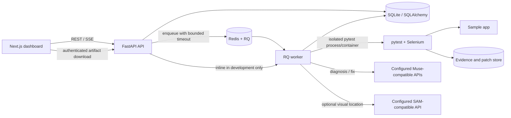
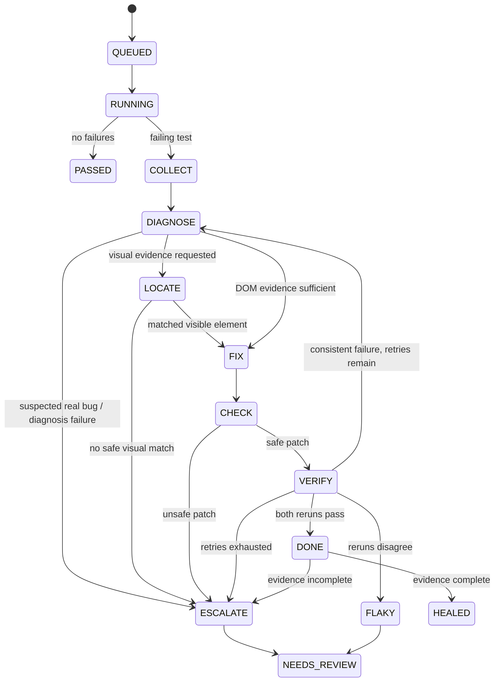

# HealTest architecture

HealTest is a review-first Selenium test repair prototype. The API owns
persistence and job state; the worker runs tests, collects evidence, and
executes the diagnosis/repair workflow. Proposed patches are never applied to
the user's source tree automatically.

## Components and trust boundaries

- **Dashboard:** `frontend/` consumes the REST API, observes run snapshots over
  SSE with polling fallback, and provides patch review/approval.
- **API and state:** `backend/app/main.py` validates input, limits request
  bodies and job submissions, and exposes project, run, patch, artifact, and
  benchmark resources. SQLAlchemy stores state in SQLite by default.
- **Queue and worker:** Redis/RQ is used when `REDIS_URL` is configured. A
  configured queue failure is returned explicitly; it never silently runs
  inline. Without Redis, development runs inline. RQ jobs have a configurable
  execution timeout, and old queued/running records are finalized as errors
  when job status is read.
- **Test runner:** `backend/app/runner.py` selects local development execution
  or a fresh constrained Docker container. The worker's test target must be
  reachable on its configured network. Browser evidence is written to the
  artifact store and referenced in the database.
- **Model integrations:** `backend/app/ai_gateway/` handles diagnosis and fix
  requests. The optional visual adapter is `backend/app/vision.py`. Provider
  endpoints, model identifiers, and credentials are configured by the
  operator, not guessed by the application.
- **Persistence:** `backend/app/models.py` stores projects, runs, test results,
  attempts, evidence references, patches, and benchmark reports. The SQLite
  compatibility migration adds the supported new columns at startup.

## Run and repair state flow

Each proposed diff is applied to a temporary copy and checked for test-only
paths, preserved assertions, bounded size, and unique locators in captured
DOM. The affected test is run twice against that patched copy. Only two
passing results count as healed; disagreement is recorded as `flaky` and
escalated for human review. The original test tree is untouched. Explicit
approval creates a separate copy for review.

## Hardening defaults

- API request bodies are limited to 1 MiB by default.
- Job submission is limited to 10 requests per client per 60 seconds by
  default; this in-memory limit is per API process.
- RQ execution timeout defaults to 1,800 seconds. Stale queued/running work is
  finalized after the timeout plus a 60-second grace period.
- Pytest has its own wall-clock timeout (`HEALTEST_TIMEOUT_S`).
- Local inline execution is for development. Use the constrained Docker mode
  and isolated internal network for untrusted test suites.

Override defaults with the `HEALTEST_MAX_REQUEST_BYTES`,
`HEALTEST_JOB_RATE_LIMIT`, `HEALTEST_JOB_RATE_WINDOW_S`,
`HEALTEST_JOB_TIMEOUT_S`, and `HEALTEST_STALE_JOB_GRACE_S` environment
variables. Invalid or non-positive values fail configuration instead of
silently disabling a limit.

## Known acceptance limits

This architecture describes implemented behavior, not a production security
guarantee. The rate limiter is process-local, stale records are finalized on
API reads rather than by a background sweeper, SQLite migration support is
deliberately small, and sandbox safety depends on operator-controlled Docker
and network configuration. Live model/SAM behavior and the full Selenium
benchmark require configured endpoints and a browser-enabled worker.
