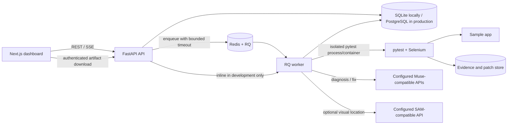
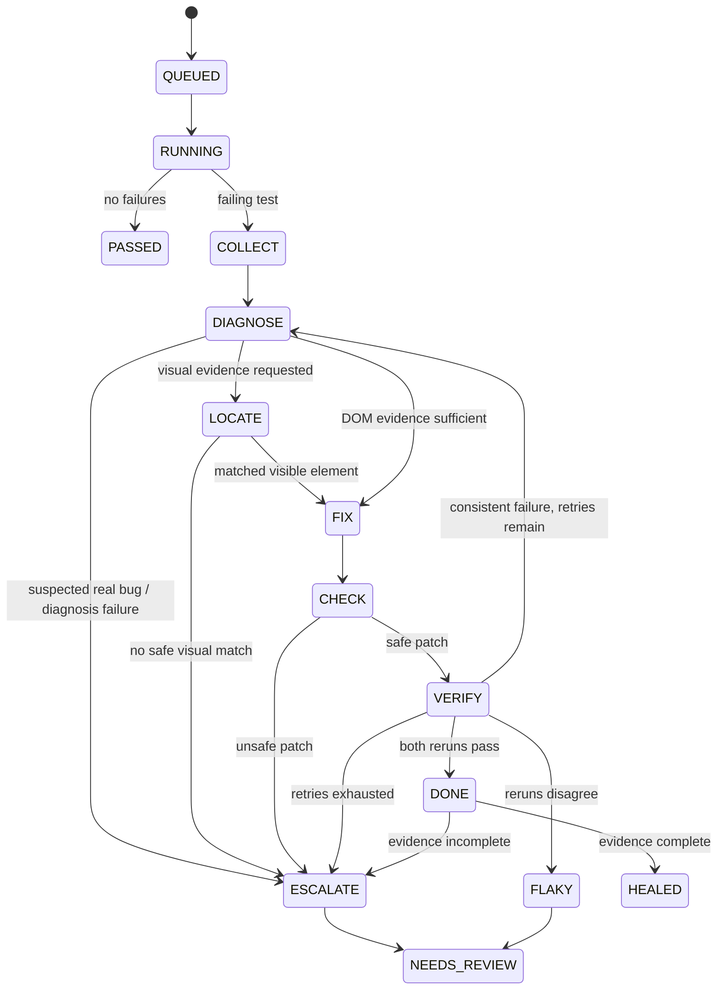

# HealTest architecture

HealTest is a review-first Selenium test repair prototype. The API owns
persistence and job state; the worker runs tests, collects evidence, and
executes the diagnosis/repair workflow. Proposed patches are never applied to
the user's source tree automatically.

## Components and trust boundaries

- **Dashboard:** `frontend/` consumes the REST API, observes run snapshots over
  SSE with polling fallback, and provides patch review/approval.
- **API and state:** `backend/app/main.py` validates input, limits request
  bodies and job submissions, and exposes project, run, patch, artifact, and
  benchmark resources. The API requires authentication; production validates
  Cognito access tokens and scopes projects, runs, patches, artifacts, and
  benchmarks to the token subject. SQLAlchemy stores state in SQLite locally
  and PostgreSQL in production.
- **Queue and worker:** Redis/RQ is used when `REDIS_URL` is configured. A
  configured queue failure is returned explicitly; it never silently runs
  inline. Without Redis, development runs inline. RQ jobs have a configurable
  execution timeout. Production requires TLS Redis and has a separate
  scheduled stale-job maintenance command.
- **Test runner:** `backend/app/runner.py` defaults to Docker and never falls
  back to local execution. Local subprocess execution requires an explicit
  trusted-development opt-in. In Docker mode, the worker requires
  a remote Docker daemon over mutual TLS; the HealTest host socket is not
  mounted. The daemon must be isolated from the application host, and its
  pre-created test network and sandbox image must be provisioned separately.
  The test target must be reachable on that network. Browser evidence is
  streamed back to the artifact store and referenced in the database.
- **Model integrations:** `backend/app/ai_gateway/` handles diagnosis and fix
  requests. The optional visual adapter is `backend/app/vision.py`. Provider
  endpoints, model identifiers, and credentials are configured by the
  operator, not guessed by the application.
- **Persistence:** `backend/app/models.py` stores projects, runs, test results,
  attempts, evidence references, patches, and benchmark reports. Production
  requires PostgreSQL, shared persistent artifact storage, and a one-off
  migration task before API deployment; automatic startup migrations are
  disabled.

## Run and repair state flow

Each proposed diff is applied to a temporary copy and checked for test-only
paths, preserved assertions, bounded size, and unique locators in captured
DOM. The affected test is run twice against that patched copy. Only two
passing results count as healed; disagreement is recorded as `flaky` and
escalated for human review. The original test tree is untouched. Explicit
approval creates a separate copy for review.

## Hardening defaults

- API request bodies are limited to 1 MiB by default.
- Job submission is limited to 10 requests per authenticated subject per 60
  seconds by default. Production stores the sliding window in shared Redis;
  local development uses an in-memory limiter.
- RQ execution timeout defaults to 1,800 seconds. Stale queued/running work is
  finalized after the timeout plus a 60-second grace period.
- Pytest has its own wall-clock timeout (`HEALTEST_TIMEOUT_S`).
- Local inline execution is for development, not untrusted suites. Docker mode
  requires `DOCKER_HOST` to use a TLS-verified TCP endpoint with client
  certificates. The remote daemon grants container-management powers to the
  worker and must run on a dedicated isolated host/VM.

Override defaults with the `HEALTEST_MAX_REQUEST_BYTES`,
`HEALTEST_JOB_RATE_LIMIT`, `HEALTEST_JOB_RATE_WINDOW_S`,
`HEALTEST_JOB_TIMEOUT_S`, and `HEALTEST_STALE_JOB_GRACE_S` environment
variables. Invalid or non-positive values fail configuration instead of
silently disabling a limit.

## Known acceptance limits

This architecture describes implemented behavior, not a production security
guarantee. Production readiness still depends on operator-provisioned Cognito,
AWS networking and secrets, backups and recovery testing, shared persistent
artifact storage, and isolated remote Docker configuration. The remote Docker
daemon grants container-management privileges to the worker; mutual TLS does
not make the daemon a sandbox boundary. Live model/SAM behavior and the full
Selenium benchmark require configured endpoints and a browser-enabled worker.
